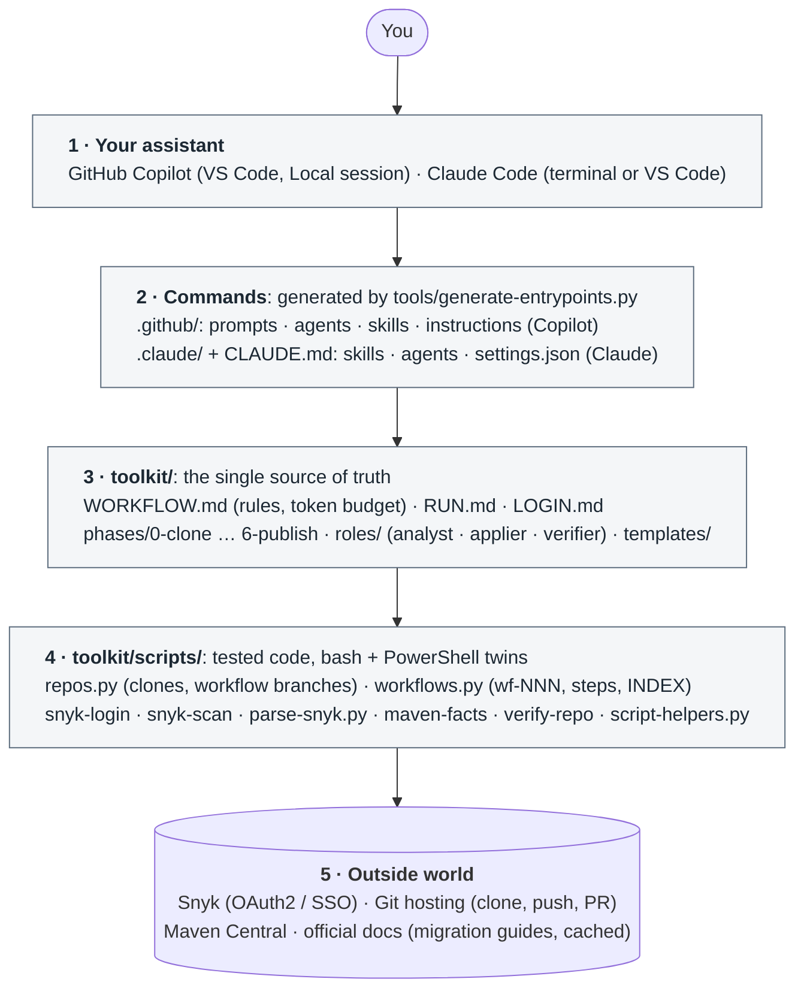
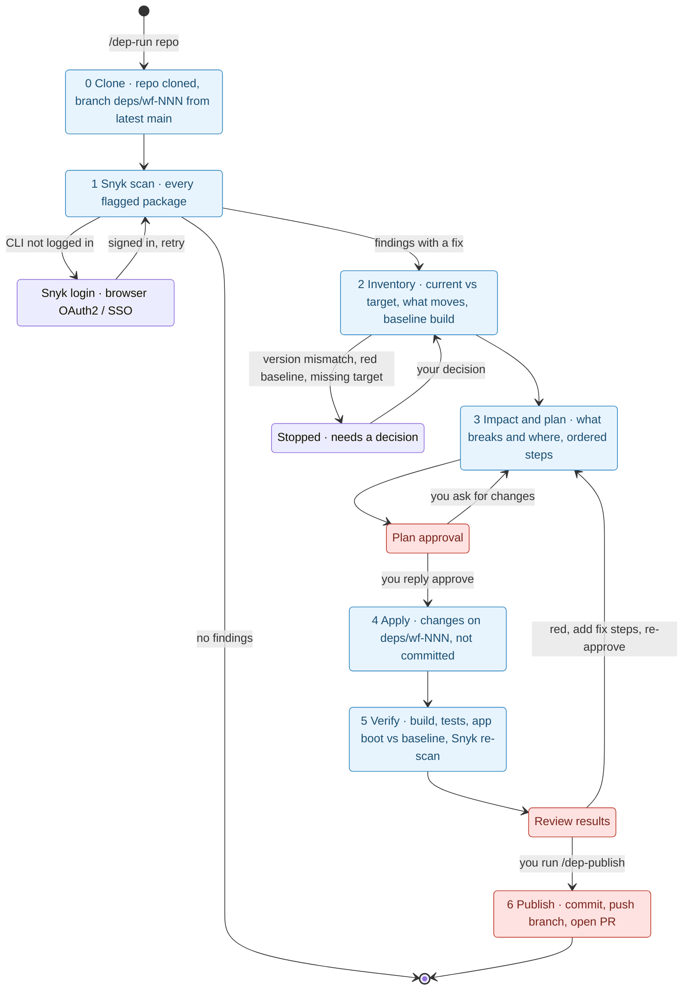
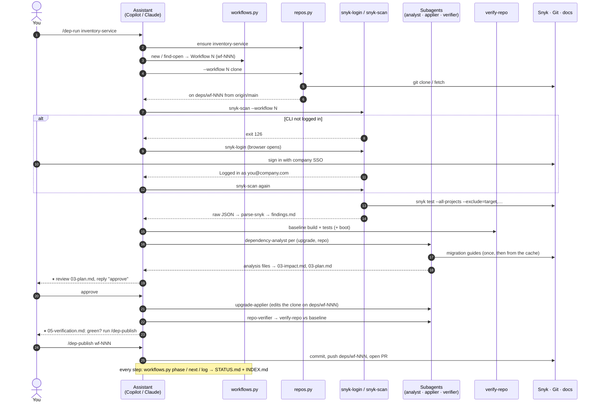
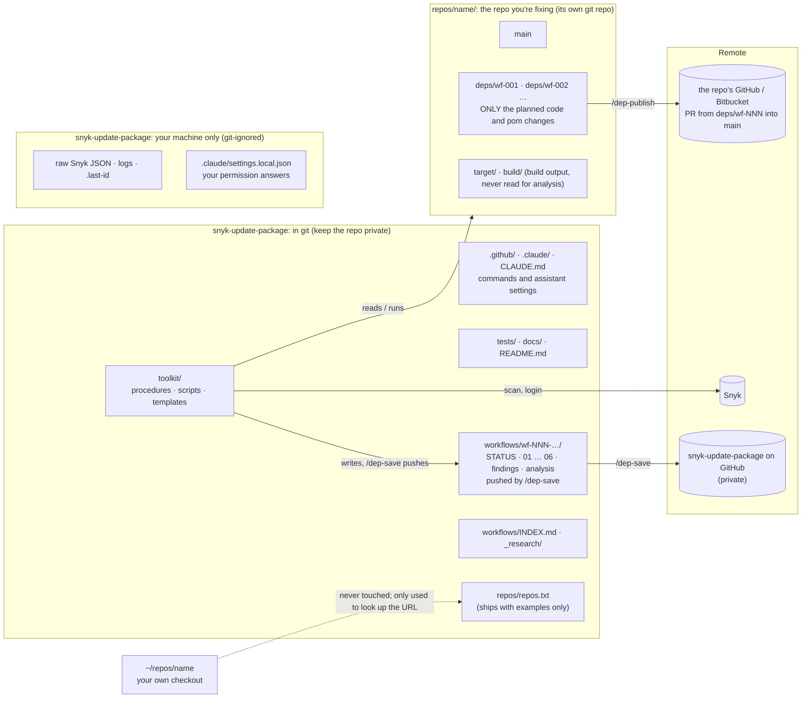
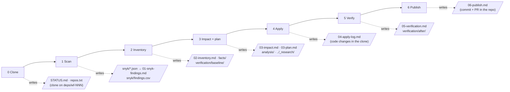

# Architecture

How `snyk-update-package` is put together, how a workflow runs, and where every file lives.
The diagrams are [Mermaid](https://mermaid.js.org/): GitHub renders them on this page. To change one, edit the text
below.

- [1. Components](#1-components)
- [2. The workflow: steps, stops and gates](#2-the-workflow-steps-stops-and-gates)
- [3. One `/dep-run`, in order](#3-one-dep-run-in-order)
- [4. Where every file lives](#4-where-every-file-lives)
- [5. What each step reads and writes](#5-what-each-step-reads-and-writes)

---

## 1. Components

You talk to an assistant (GitHub Copilot or Claude Code). The `/dep-*` commands are thin entry points: all real
instructions live in `toolkit/`, and all real work is done by the scripts, which talk to the outside world.

| Layer | What it is | Why it's separate |
|-------|------------|-------------------|
| **Entry points** (`.github/`, `.claude/`) | The `/dep-*` commands for each assistant: a few lines each, pointing at `toolkit/` | Both assistants behave the same; they're regenerated from one spec, so they can't drift |
| **Toolkit** (`toolkit/*.md`) | The procedures: what each step does, when to stop, the rules | One place to change behaviour, for both assistants |
| **Scripts** (`toolkit/scripts/`) | Everything that can be done by code: cloning, branching, scanning, parsing, building, tracking | Deterministic and tested, instead of left to the AI |
| **Subagents** (`roles/`) | Focused helpers: analyse one package in one repo, apply the plan in one repo, verify one repo | Run in parallel; each has strict limits (read-only, or edit only what the plan says) |

---

## 2. The workflow: steps, stops and gates

Each run is **Workflow N** (`wf-NNN`). `/dep-run` moves through the steps by itself and stops only where it needs
you. The two red gates never pass without you.

| Step | Command | Changes the repo? | Stops for you when |
|------|---------|-------------------|--------------------|
| 0 Clone | `/dep-clone` | creates/switches the clone's branch `deps/wf-NNN` | clone failed, no main branch, or another workflow's unpublished changes are there |
| 1 Snyk scan | `/dep-scan` | no | no Snyk CLI, or the login didn't complete |
| 2 Inventory | `/dep-inventory` | no (build output only) | a discrepancy, a missing target version, or a red baseline |
| 3 Impact + plan | `/dep-analyze` | no | **always**: approve the plan |
| 4 Apply | `/dep-apply` | **yes**, on `deps/wf-NNN`, uncommitted | a step stays red after two fix attempts |
| 5 Verify | `/dep-verify` | no (build output only) | **always**: review the results |
| 6 Publish | `/dep-publish` | commits and pushes the branch | only runs when **you** start it |

---

## 3. One `/dep-run`, in order

Who calls whom during a typical run. Everything an assistant decides is backed by a script call, and every step
writes its result to a file before moving on.

---

## 4. Where every file lives

Three places, with clear boundaries: what's shared in git, what stays on your machine, and the repo you're fixing.

| Rule | Enforced by |
|------|-------------|
| The repo gets **only** the planned code and package changes; every document, log and report goes to `workflows/` | the procedures, and `verify-repo` reporting anything a build leaves behind (`left_in_repo`); tested end to end |
| Your own checkouts are never touched | `repos.py` only reads their URL; tested |
| Build output and dependencies (`target/`, `node_modules/`, `.git/` …) are never searched, scanned or edited | `toolkit/ignore-dirs.txt` → Snyk `--exclude`, pom discovery, `.vscode/settings.json`, `.claude/settings.json` |
| Workflow records go to **this** repo's GitHub, never raw Snyk JSON or logs; only while the repo is private | `workflows.py save` (commits only `workflows/`, refuses on a public repo); `.gitignore`; tested |
| Nothing is committed or pushed to a **target repo** except by `/dep-publish`, which you start | manual-only commands (Claude) and send-only-by-you handoffs (Copilot); tested |

---

## 5. What each step reads and writes

All inside `workflows/wf-NNN-<repo>/` unless noted. Each step reads the previous step's files, not the chat, which
is why a run can resume in a fresh chat at any stop.

| Step | Reads | Writes |
|------|-------|--------|
| 0 Clone | `repos/repos.txt` (or the workflow's `repos.txt`) | `STATUS.md`, the clone on `deps/wf-NNN` |
| 1 Snyk scan | the clone | `snyk/<repo>.json` (raw), `snyk/findings.{md,csv,json}`, `01-snyk-findings.md` |
| 2 Inventory | `01-snyk-findings.md` (scope), the clone's poms | `facts/<repo>/`, `verification/baseline/<repo>/`, `02-inventory.md` |
| 3 Impact + plan | `02-inventory.md`, `facts/`, `_research/`, the clone's code (`git grep`) | `analysis/`, `03-impact.md`, `03-plan.md` (+ `_research/` the first time) |
| 4 Apply | `03-plan.md` (approved) | code changes in the clone, `04-apply-log.md` |
| 5 Verify | the clone, `verification/baseline/`, `03-impact.md` | `verification/after/`, `05-verification.md` |
| 6 Publish | `04-apply-log.md`, `03-impact.md`, `05-verification.md` | a commit + PR in the repo, `06-publish.md` |
